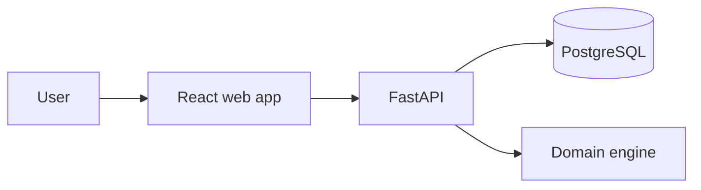

<!-- This is a TEMPLATE. Replace placeholders with VERIFIED, project-specific facts. Remove unused sections before publishing. -->

# PROJECT_NAME

> **ONE_SENTENCE_VALUE_PROPOSITION**

<!-- Only after CI and license actually exist: add their REAL badges here. -->

<!-- Add an ACTUAL product screenshot if it exists: -->
<!--  -->

## The problem

Write 2–3 sentences explaining the real problem, target users, and why this solution is different from a tutorial app.

## Highlights

| Feature | What it does | Status |
| --- | --- | --- |
| Verified feature 1 | Specific capability | Implemented |
| Verified feature 2 | Specific capability | Implemented |

## How it works



Replace this high-level diagram with the ACTUAL architecture, including the correct backend and specialized engine.

## Quick start

**Prerequisites:** Docker Desktop / Docker Engine with Compose; list any other prerequisites.

```bash
git clone https://github.com/USERNAME/REPOSITORY.git
cd REPOSITORY
cp .env.example .env
docker compose up --build
```

Only keep these commands if they work. Explain platform-specific alternatives and where to open the app and API docs.

## 60-second demo

1. Start the application.
2. Load the included synthetic sample data using the actual command/button.
3. Perform the product's defining workflow.
4. Verify the result and understand what it does **not** prove.

## API example

Provide a real `curl` example from the implemented OpenAPI specification, including expected response shape. Remove this section if not exposed.

## Engineering decisions

Discuss nontrivial technology choices, trade-offs, algorithm design, and alternatives. Link to `docs/ARCHITECTURE.md`.

## Evaluation and testing

List exact test commands, the evaluation dataset's origin and size, key metrics and definitions. Never invent a benchmark, accuracy, coverage, performance number or usage statistic.

## Security, privacy, and limitations

Explain sample data policy, PII handling, scope of claims, restrictions on consequential HR decisions, and status of any auth controls. Link to `SECURITY.md` and `docs/LIMITATIONS.md`.

## Project structure

Provide an accurate short file tree.

## Roadmap

- [ ] Planned, not implemented capability 1
- [ ] Planned, not implemented capability 2

## Contributing

Link to `CONTRIBUTING.md`, with steps to run tests before opening a PR.

## License

State the actual license after adding LICENSE; otherwise mark license selection pending. Do not misrepresent third-party licenses.
